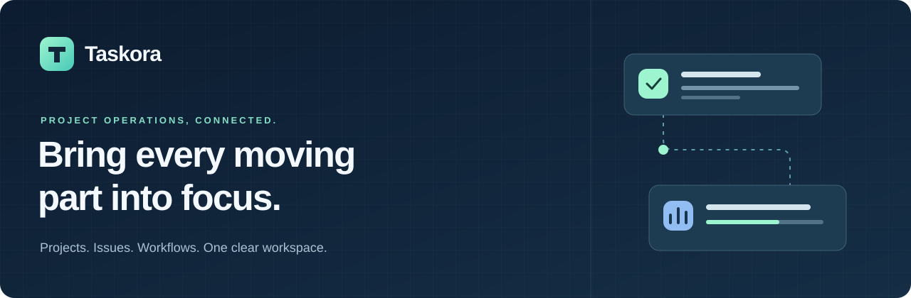
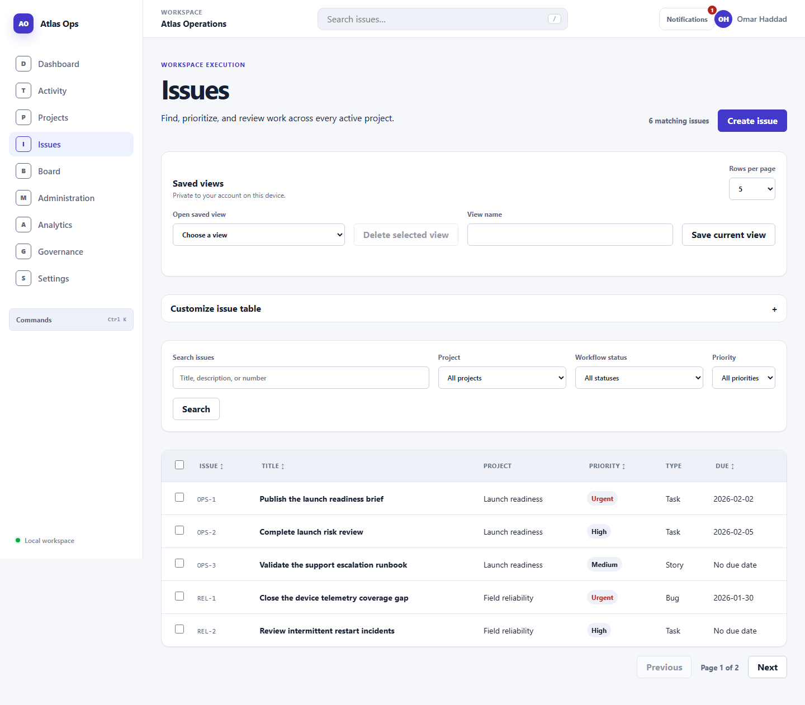
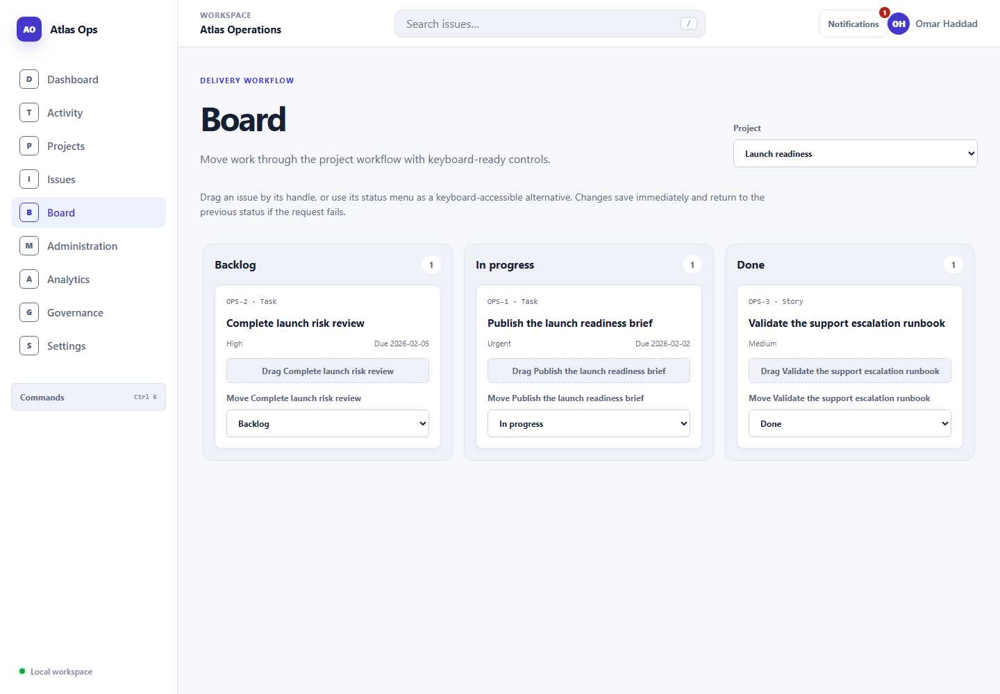

<p align="center">
  
</p>

<p align="center">
  <strong>A connected workspace for projects, issues, and team operations.</strong><br>
  Plan work, move it forward, and understand what needs attention.
</p>

<p align="center">
  <a href="#product-tour">Product tour</a> ·
  <a href="#run-locally">Run locally</a> ·
  <a href="#architecture">Architecture</a> ·
  <a href="#quality-checks">Quality checks</a>
</p>

<p align="center">
  
  
  
  
</p>

## A clearer view of the work

Taskora brings project planning, issue tracking, collaboration, and operational
reporting together in a single React application. Move from a workspace overview
to the details of an issue, keep ownership visible, and manage how work moves
through each project's workflow.

The repository was originally developed as **Atlas Ops**. The current application
still displays that name; the screenshots below show the actual app, unchanged.

## Product tour

### Start with the bigger picture

A configurable dashboard brings issues, project health, and analytics into one
view, with quick access to the work behind the numbers.


### Turn a list of issues into a plan

Search and filter work, sort and paginate results, customize columns, and apply
bulk actions. Saved views and URL-backed filters help you return to the same
working context.



### Keep work moving

A project Kanban board makes workflow progress visible. Move issues with pointer
controls or the equivalent keyboard workflow.



## Built around everyday operations

| Area | What you can do |
| --- | --- |
| **Projects & ownership** | Browse projects, manage membership, transfer leadership, and configure workflows. |
| **Issues & planning** | Create and edit work, assign owners, set priorities, filter results, and make bulk changes. |
| **Team collaboration** | Comment, mention teammates, watch issues, subscribe to projects, and review activity. |
| **Search & navigation** | Find work globally, open the command palette, use keyboard shortcuts, and restore saved views. |
| **Analytics & reporting** | Explore time-ranged metrics, workspace activity, and protected governance reports. |
| **Access & preferences** | Administer workspace membership and invitations, configure notifications, and personalize views. |

## Run locally

**Requirements:** Node.js **20.19 or newer within the 20.x release line**, and npm **10**.
The repository includes `.nvmrc` and a frozen `package-lock.json`.

```bash
git clone https://github.com/Akrambadr99/Taskora.git
cd Taskora
npm ci
npm run dev
```

Open the local URL printed by Vite. The app includes fixture data, so you can
explore it without API keys, an external service, or database setup.

> **Data model:** application data is served by a typed asynchronous gateway over
> an in-memory store. Authoritative data changes do not persist across a full
> reload. Browser preferences use local storage. This is a self-contained frontend,
> not a hosted service or a durable backend.

## Architecture

React presentation, query orchestration, domain rules, and data access have
separate responsibilities. TanStack Query coordinates server-state reads and
mutations; React Router handles navigation and lazy-loaded pages.

```text
src/
├── app/           Routes, providers, layouts, and page composition
├── features/      Product interactions and query coordination
├── domain/        Entities, identifiers, authorization, and invariants
├── data/          Typed gateway, fixtures, store, and network simulation
├── components/    Reusable dialogs, tables, and interaction primitives
├── interactions/  Keyboard shortcuts and focus helpers
├── preferences/   Browser preference storage and codecs
└── test/          Shared test utilities
```

The gateway models request cancellation, revision conflicts, and asynchronous
failures. Feature code stays behind that boundary; lint rules enforce the
architectural layers. A remote transport can implement the gateway contracts
without coupling presentation code to database details.

## Quality checks

| Command | Purpose |
| --- | --- |
| `npm run lint` | ESLint, architectural boundaries, and zero-warning checks |
| `npm run typecheck` | TypeScript project checks |
| `npm test` | Unit, integration, and rendered interaction tests |
| `npm run test:coverage` | Coverage reporting and configured thresholds |
| `npm run test:e2e` | Cross-feature Chromium browser journeys |
| `npm run build` | Production build, TypeScript, and entry-bundle budget |

Install the browser before running end-to-end tests:

```bash
npx playwright install chromium
npm run test:e2e
```

Vitest covers domain rules, data contracts, cache coordination, concurrency, and
rendered interactions. Playwright covers journeys through the running app,
including keyboard and focus behavior. Tests are self-contained and do not
require private credentials or external APIs.

---

<p align="center">
  <strong>Taskora</strong><br>
  Projects, people, and progress — in one workspace.
</p>
